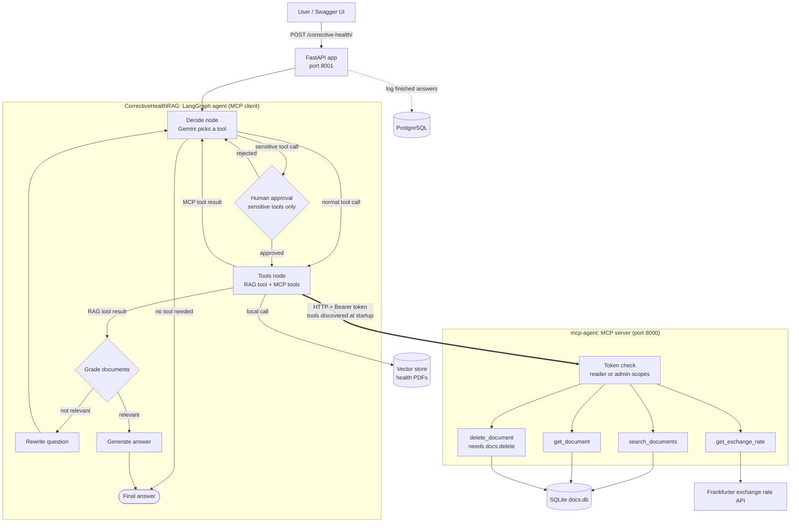
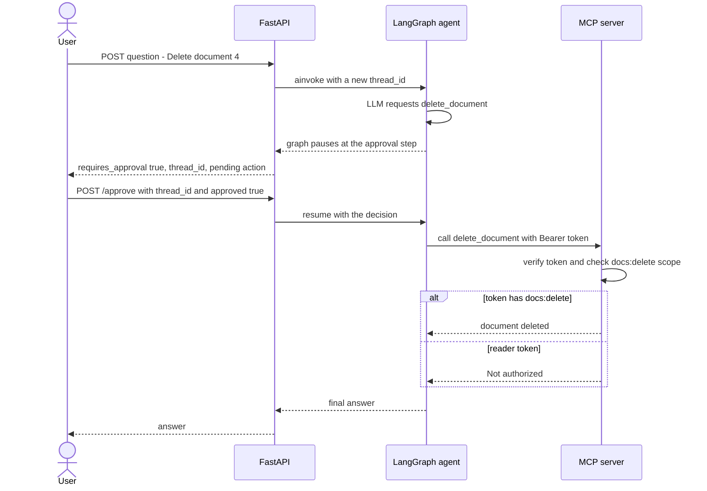

# CorrectiveHealthRAG

A FastAPI-backed Agentic RAG assistant that answers questions about **depression and hypertension** using official health documents from **NIMH and WHO**.

Built with **LangGraph** using the Corrective RAG pattern, served through **FastAPI**, with query history logged to **PostgreSQL**.

The agent is also an **MCP client**. It discovers tools from a separate MCP server at startup (company documents, exchange rates, document deletion) and uses them next to its own health RAG tool. Sensitive actions need human approval and the right server permission.

## How It Works

```text
Question
   ↓
Decide (Gemini picks a tool, or answers directly)
   ├── no tool needed ──────────────────────────→ Answer
   ├── health question → search_health_docs (local RAG)
   │        ↓
   │   Grade documents → Rewrite if needed (loops back to Decide)
   │        ↓
   │   Generate answer
   ├── other request → MCP tool → back to Decide → Answer
   └── sensitive MCP tool → Human approval → MCP tool → back to Decide → Answer
   ↓
Log finished answers to PostgreSQL
```

The system:

* Decides whether a question needs the health documents, an MCP tool, or no tool
* Retrieves relevant chunks from the source PDFs for health questions
* Grades whether the retrieved content answers the question, and rewrites the question if not (up to a set limit)
* Sends MCP tool results straight back to the model, without grading, so it can write the answer
* Pauses before any sensitive tool runs and waits for a human decision
* Logs every finished question, answer, and source filename(s) to PostgreSQL

## Architecture



### Approval flow for a sensitive action



## MCP Integration

**Dynamic tool discovery.** At startup the app connects to the MCP server, lists its tools, and builds the graph with them. The code contains no MCP tool names. Add a tool to the server, restart the app, and the agent can use it.

**Routing rule.** After a tool runs, the graph checks which tool it was:

* `search_health_docs` result goes to grading, then to the answer step
* MCP tool result goes back to the decide node, which writes the answer

**Two locks on sensitive actions.**

1. **Human approval (in the agent).** Tools listed in `SENSITIVE_TOOLS` (`app/src/node/approval.py`) pause the graph. The caller must send an explicit decision to `/approve`. Anything other than a clear `true` counts as a rejection.
2. **Permission (on the MCP server).** The server accepts `delete_document` only for a token with the `docs:delete` scope. The agent uses the read-only token by default, so a deletion is refused even after approval.

**Safe failures.**

| Situation | What happens |
|---|---|
| MCP server down or token refused at startup | The app starts with the health RAG tool only and logs a warning |
| Tool returns an error | The error goes back to the model, which tells the user. The app does not crash |
| Model calls a tool that does not exist | Handled as a tool error |
| Invalid tool arguments | Rejected before the tool runs |

## Tech Stack

* **LangGraph**: agentic RAG orchestration (Corrective RAG pattern), human approval with `interrupt`
* **MCP** (`langchain.mcp` adapter with the `fastmcp` client): tool discovery and calls
* **FastAPI**: HTTP API layer
* **Gemini 3.1 Flash Lite**: generation, rewriting, and tool selection
* **HuggingFace `all-MiniLM-L6-v2`**: embeddings
* **InMemoryVectorStore**: vector storage (rebuilt from source PDFs on startup)
* **PostgreSQL + SQLAlchemy + Alembic**: query history logging and migrations
* **pytest**: tests

## Project Structure

```text
CorrectiveHealthRAG/
│
├── app/
│   ├── main.py                  # FastAPI app, startup tool discovery (lifespan)
│   ├── config.py                # LLM client setup
│   ├── settings.py              # Environment variable config (pydantic-settings)
│   │
│   ├── router/
│   │   └── corrective_health_router.py   # /corrective-health and /approve routes
│   │
│   ├── schema/
│   │   └── corrective_health_schema.py   # Pydantic request/response models
│   │
│   ├── model/
│   │   └── corrective_health_model.py    # SQLAlchemy CorrectiveRAGModel (query log table)
│   │
│   ├── db/
│   │   ├── database.py          # Engine, SessionLocal, Base
│   │   └── session.py           # get_db dependency
│   │
│   └── src/
│       ├── ingest.py
│       ├── retriever.py         # Local RAG tool: search_health_docs
│       ├── mcp_client.py        # MCP adapter with bearer token
│       ├── state.py
│       ├── logger.py
│       ├── graph.py             # build_graph(mcp_tools, checkpointer)
│       ├── utils/
│       │   └── extract_content.py
│       └── node/
│           ├── decide.py        # Tool selection
│           ├── approval.py      # Human approval for sensitive tools
│           ├── grade.py
│           ├── rewrite.py
│           └── generate.py
│
├── alembic/                     # Database migrations
│   └── versions/
├── alembic.ini
│
├── data/
│   └── source_docs/             # depression.pdf, hypertension.pdf
│
├── tests/
│   ├── conftest.py              # Fake LLM and fake MCP tools
│   ├── test_graph_routing.py
│   ├── test_approval.py
│   ├── test_api.py
│   ├── test_mcp_live.py         # Needs the MCP server running (skipped if not)
│   ├── test_queries.py          # Manual script for the RAG graph
│   ├── check_mcp_tools.py       # Manual script: discover and call a tool
│   └── run_mcp_graph_demo.py    # Manual script: runs questions through the real LLM
│
├── docs/
│   └── mcp-vs-direct-integration.md
│
├── requirements.txt
└── .env                         # not committed, see Setup
```

## Setup

You need two projects running: the MCP server and this app.

**1. MCP server.** Follow the setup in the `mcp-agent` README. Create its `.env` with `MCP_READER_TOKEN` and `MCP_ADMIN_TOKEN`, run `python seed_db.py`, then start it with `python server.py`.

**2. This app.**

```bash
python -m venv venv
source venv/bin/activate      # on Windows: venv\Scripts\activate

pip install -r requirements.txt
```

`requirements.txt` needs these lines for MCP and tests, next to the existing ones:

```text
langchain[mcp]>=1.4.6,<2
fastmcp
pytest
```

Create a `.env` file in the project root:

```env
GOOGLE_API_KEY=<your Gemini API key>
DATABASE_URL=<your PostgreSQL connection string>
MCP_TOKEN=<same value as MCP_READER_TOKEN in the mcp-agent .env>
```

Optional: `MCP_SERVER_URL` (default `http://localhost:8000/mcp`).

Never commit `.env`. Use the **reader** token for `MCP_TOKEN`. Use the admin token only for a deliberate delete demo.

Add the required PDFs to:

```text
data/source_docs/
```

Run database migrations:

```bash
alembic upgrade head
```

## Running the App

Start the MCP server first (port 8000), then this app. The MCP server uses port 8000, so run the API on 8001:

```bash
uvicorn app.main:app --port 8001
```

Startup takes a few minutes while the PDFs are embedded on CPU. Wait for this log line:

```text
MCP tools discovered: ['search_documents', 'get_document', 'get_exchange_rate', 'delete_document']
```

Do not use `--reload` while testing. It can leave an old process running on the port, and a changed `.env` is not picked up without a full restart.

Interactive API docs:

```text
http://127.0.0.1:8001/docs
```

## API

### POST `/corrective-health/`

Request:

```json
{
  "question": "What is our refund policy?"
}
```

Response:

```json
{
  "answer": "Refunds are issued within 14 days of purchase.",
  "tools_used": ["search_documents", "get_document"],
  "thread_id": "a05bfd6a-cf49-430d-a5c4-18798043fec9",
  "requires_approval": false,
  "pending_actions": []
}
```

When the agent wants to run a sensitive tool, nothing runs yet:

```json
{
  "answer": "This action needs human approval before it runs.",
  "tools_used": [],
  "thread_id": "2af163d6-82b3-4bdb-b8bf-beaf12e57b4b",
  "requires_approval": true,
  "pending_actions": [
    { "tool": "delete_document", "args": { "doc_id": 2 } }
  ]
}
```

### POST `/corrective-health/approve`

Request:

```json
{
  "thread_id": "2af163d6-82b3-4bdb-b8bf-beaf12e57b4b",
  "approved": true
}
```

Returns the final answer in the same format. An unknown or already finished `thread_id` returns `404`.

Each finished call is logged to the `corrective_rags` table in PostgreSQL, including the question, answer, source filename(s), and timestamp. A request that is waiting for approval is logged when it finishes.

## Testing

**Automated tests**

```bash
pytest tests -v
```

| Server running? | Result |
|---|---|
| Yes, with `MCP_TOKEN` set | 35 passed |
| No | 28 passed, 7 skipped (live tests need the server) |

The automated tests do not call Gemini, do not touch PostgreSQL, and do not load the embedding model. They use a scripted fake LLM and fake MCP tools.

| File | Covers |
|---|---|
| `test_graph_routing.py` | RAG vs MCP routing, grading skipped for MCP results, tool errors, invalid arguments, unknown tool, MCP tools unavailable |
| `test_approval.py` | Sensitive tool pauses, approve runs it once, reject never runs it, unclear decision is a rejection, approvals are separate per thread |
| `test_api.py` | Endpoints, approval over HTTP, 404 for unknown thread, DB logging after approval only, startup when the MCP server is down |
| `test_mcp_live.py` | Real server: tool discovery, successful call, server errors, missing token and wrong token refused, unreachable server |

**Manual demos** (restart uvicorn after each `.env` change, and run `python seed_db.py` in `mcp-agent` before starting):

| Demo | Setup | Action | Expected |
|---|---|---|---|
| Both locks | `MCP_TOKEN` = reader token | `Delete document 4.`, then approve | The agent says it is not authorized. Document 4 still exists |
| Admin delete | `MCP_TOKEN` = admin token | `Delete document 4.`, then approve | Document 4 is deleted |
| No token | Remove `MCP_TOKEN` | Start the app | Log: `MCP server unavailable or access refused`. The MCP server log shows `401`. Health questions still work, MCP tools are gone |

Manual scripts (they call the real MCP server and, for the second one, Gemini):

```bash
python -m tests.check_mcp_tools
python -m tests.run_mcp_graph_demo
python -m tests.test_queries
```

## Troubleshooting

| Problem | Cause | Fix |
|---|---|---|
| App still uses MCP tools after removing `MCP_TOKEN` | An old uvicorn is still running on the port, or the `.env` was not reloaded | Stop every process on the port (`netstat -ano \| findstr :8001`, then `taskkill /PID <number> /F`) and start again |
| `Not authorized` on delete after approving | The agent uses the reader token | Expected. Use the admin token for a deliberate delete demo |
| Same denial with the admin token | A program still runs with the old token | Restart the MCP server and uvicorn |
| Slow answers, `503 Service Unavailable` in the log | The free Gemini model is busy. The client retries by itself | Wait and try again |
| Delete tests fail in `mcp-agent` | A document was deleted by hand | Run `python seed_db.py` |
| New MCP tool is not visible | Tools are discovered once at startup | Restart the app |

## Known Limitations

* `/approve` has no user login. Anyone who has a `thread_id` can approve. A real deployment needs authenticated users on this endpoint.
* Paused requests are kept in memory (`MemorySaver`). A restart removes them. Use a database checkpointer in production.
* The list of sensitive tools (`SENSITIVE_TOOLS`) is set in code.
* The MCP server uses static tokens. Production should use OAuth with JWT.

## MCP vs Direct Integration

See [docs/mcp-vs-direct-integration.md](docs/mcp-vs-direct-integration.md).

## Deployment

This project is being deployed on AWS EC2 (Ubuntu) with PostgreSQL, Gunicorn, and Nginx. Deployment steps are documented separately. For a deployment that uses MCP tools, the MCP server must run as a separate service and its token must be set in the app environment.